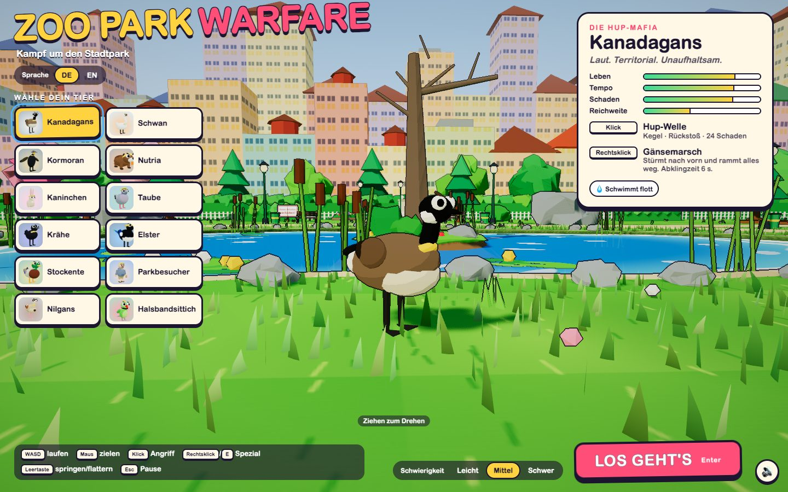
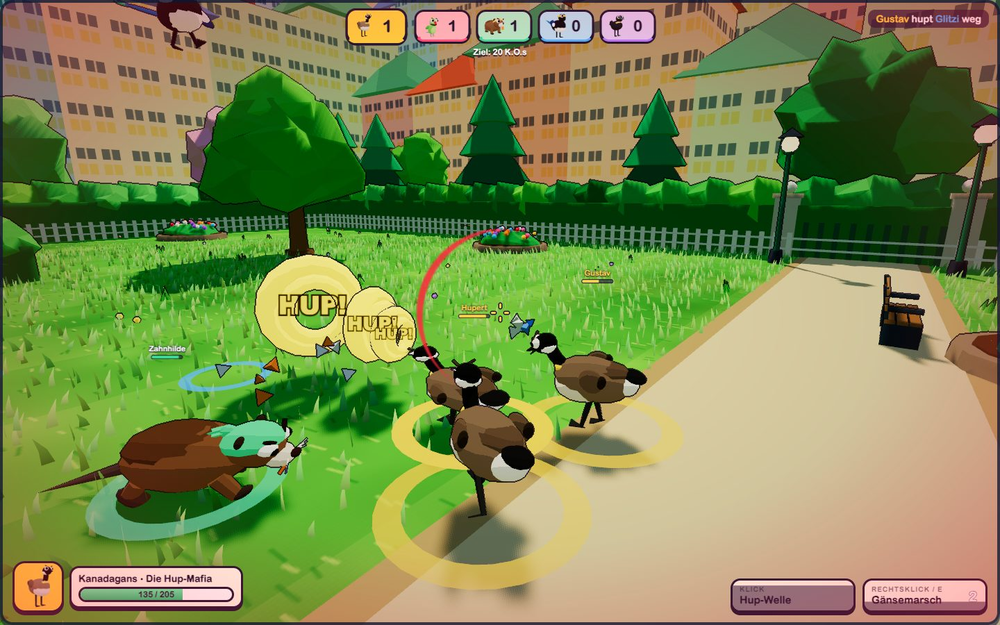
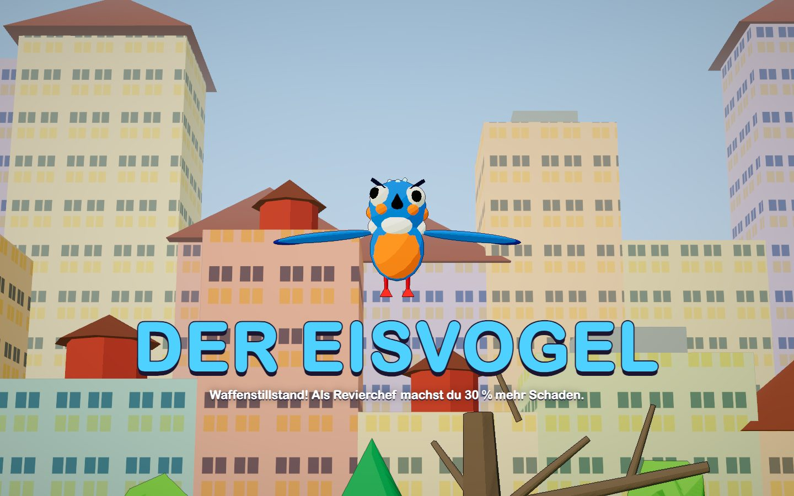

[English](README.md) · **Deutsch**

# Zoo Park Warfare

Zoo Park Warfare ist eine laute, bunte Keilerei für den Browser, gebaut mit three.js. Zwölf Fraktionen aus Stadtpark-Tieren kämpfen um die Vorherrschaft im Park. Das Siegerteam wird gekrönt, und danach müssen alle zusammen gegen den Endgegner antreten: einen riesigen Eisvogel.

**[Zoo Park Warfare im Browser spielen](https://rupertgermann.github.io/zoo-park-warfare/)**. Keine Installation nötig.

Das Spiel ist von [Karen Warfare](https://karenwarfare.fun/) inspiriert.



<p>
  
  
</p>

## So läuft eine Runde

1. **Tier wählen.** Du spielst eine von zwölf Fraktionen: Kanadagans, Schwan, Kormoran, Nutria, Kaninchen, Taube, Krähe, Elster, Stockente, Parkbesucher, Nilgans oder Halsbandsittich. Jede hat einen Grundangriff und eine Spezialfähigkeit.
2. **Revierkampf.** Fünf Teams zu je drei Tieren kämpfen im ganzen Park, und du führst dein Team an. Das erste Team mit 20 K.O.s regiert den Park und wird gekrönt. Ein gekröntes Team macht 30 % mehr Schaden am Boss.
3. **Bosskampf.** Der Eisvogel greift an, und alle überlebenden Tiere schließen Waffenstillstand. Weiche seinen Sturzflügen aus, schlag zu, solange er benommen ist, und besiege ihn, bevor deine Leben aufgebraucht sind.

Im Startbildschirm wählst du **Leicht**, **Mittel** oder **Schwer**. Auf den leichteren Stufen sind die Gegner langsamer und zielen schlechter, du nimmst weniger Schaden und hast im Bosskampf mehr Leben. Dort gibt es auch den Sprachumschalter **DE/EN**. Das Spiel merkt sich beide Einstellungen.

## Steuerung

| Eingabe | Aktion |
|---|---|
| <kbd>W</kbd> <kbd>A</kbd> <kbd>S</kbd> <kbd>D</kbd> | Laufen |
| Maus | Zielen |
| Klick | Angriff |
| Rechtsklick oder <kbd>E</kbd> | Spezialfähigkeit |
| <kbd>Leertaste</kbd> | Springen, oder flattern, wenn dein Tier fliegen kann |
| <kbd>Esc</kbd> | Pause |
| <kbd>M</kbd> | Ton an oder aus |

Das Spiel braucht einen Desktop-Browser mit WebGL 2 und Pointer Lock.

## Lokal starten

Du brauchst Node.js 24 und npm. Führe diese Befehle im Hauptverzeichnis des Repositorys aus:

```bash
npm ci
npm run dev
```

Danach http://localhost:5199 öffnen.

## Die Einzeldatei-Version bauen

```bash
npm run build:html
```

Das erzeugt `dist/zoo-park-warfare.html`. Die Datei enthält das ganze Spiel. Alle Modelle, Texturen und Sounds entstehen im Code, deshalb braucht sie keine weiteren Dateien. Du kannst sie direkt von der Festplatte öffnen oder auf jedem Webserver ablegen.

## Auf GitHub Pages veröffentlichen

Der [Deployment-Workflow](.github/workflows/pages.yml) baut die Einzeldatei bei jedem Pull Request gegen `master`. Jeder Push auf `master` baut sie erneut und veröffentlicht sie als `index.html` auf GitHub Pages. Schlägt der Build fehl, wird nichts veröffentlicht, und die bisherige Version bleibt online. Von Hand veröffentlichen kannst du im Tab **Actions** mit **Deploy game to GitHub Pages**.

## Entwicklerwerkzeuge

Alle Werkzeuge brauchen den laufenden Dev-Server und steuern das echte Spiel in einem Headless-Chromium.

| Befehl | Was er macht |
|---|---|
| `node tools/playtest.mjs <species>` | Spielt Menü, Match, Boss und Ergebnis durch, speichert Screenshots, schlägt bei Konsolenfehlern fehl |
| `node tools/sim/sim.mjs --n 4 --boss 2 [--diff leicht]` | Balance-Simulation mit Autopilot-Matches für jede Tierart |
| `node tools/look.mjs <tag> [--dpr 2] [--lang de]` | Feste Screenshots von Menü, Match, Teich und Boss, mit Bildrate und Draw Calls |
| `node tools/legs.mjs <tag> [neigung] [ids]` | Nahaufnahmen, die prüfen, ob die Beine am Körper sitzen |
| `node tools/chat-lines.mjs [de\|en]` | Gibt alle Bot-Chat-Zeilen aus und schlägt bei fehlenden Übersetzungen oder unbekannten Platzhaltern fehl. Braucht keinen Dev-Server |

`docs/brief.md` beschreibt die Schnittstellen der Module. `src/species.js` enthält die Werte aller Fraktionen, `src/i18n.js` alle Texte in beiden Sprachen.

## Lizenz

Quellcode und Screenshots des Spiels stehen unter der [MIT-Lizenz](LICENSE). three.js behält seinen eigenen MIT-Copyright-Hinweis, siehe [THIRD_PARTY_NOTICES.md](THIRD_PARTY_NOTICES.md). Die Einzeldatei-Version enthält beide Lizenztexte.

## Credits

Zoo Park Warfare ist von [Karen Warfare](https://karenwarfare.fun/) inspiriert. Gebaut mit [three.js](https://threejs.org/) und [Vite](https://vite.dev/). Die Lizenz von three.js, das im gebauten Spiel enthalten ist, steht in [THIRD_PARTY_NOTICES.md](THIRD_PARTY_NOTICES.md).
