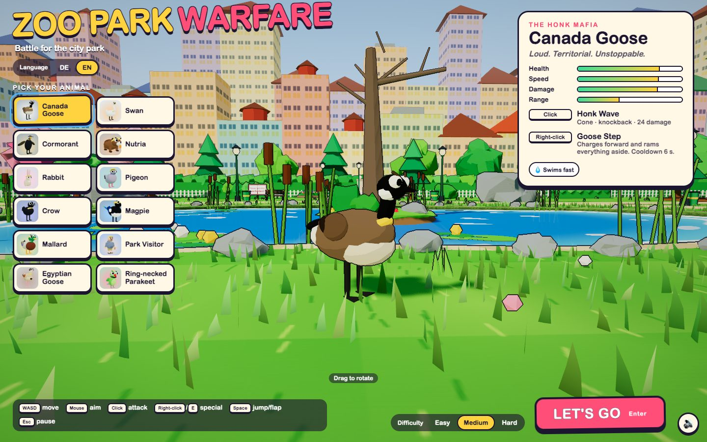
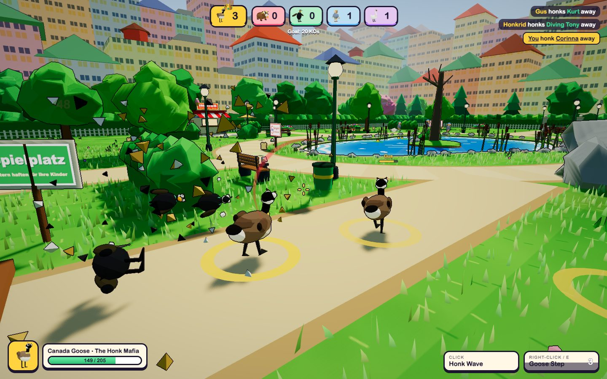
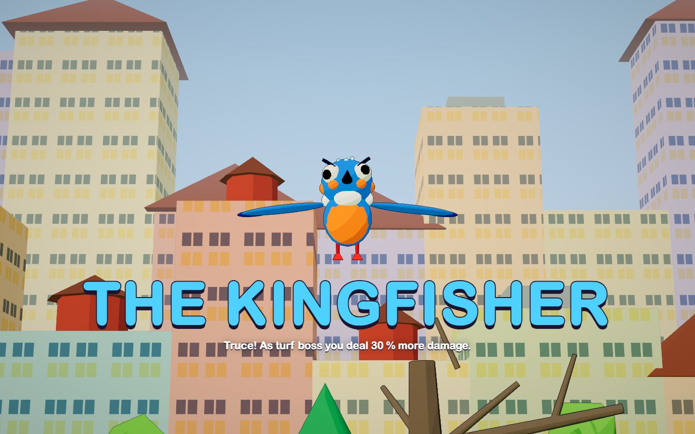

**English** · [Deutsch](README.de.md)

# Zoo Park Warfare

Zoo Park Warfare is a loud, colorful browser brawler built with three.js. Twelve factions of city-park animals fight over the park. The winning team gets a crown, and then everyone has to team up against the final boss, a giant kingfisher.

**[Play Zoo Park Warfare in your browser](https://rupertgermann.github.io/zoo-park-warfare/)**. No installation required.

The game is inspired by [Karen Warfare](https://karenwarfare.fun/).



<p>
  
  
</p>

## How a round works

1. **Pick an animal.** You play one of twelve factions: Canada Goose, Swan, Cormorant, Nutria, Rabbit, Pigeon, Crow, Magpie, Mallard, Park Visitor, Egyptian Goose or Ring-necked Parakeet. Each one has a basic attack and a special ability.
2. **Turf war.** Five teams of three fight across the park, and you lead your team. The first team to reach 20 KOs rules the park and is crowned. A crowned team deals 30 % more damage to the boss.
3. **Boss fight.** The kingfisher attacks and every surviving animal calls a truce. Dodge its dives, hit it while it is dazed, and beat it before you run out of lives.

Choose **Easy**, **Medium** or **Hard** on the start screen. Easier levels make rivals slower and less accurate, reduce the damage you take, and give you more lives in the boss fight. The start screen also has a **DE/EN** language switch. The game remembers both choices.

## Controls

| Input | Action |
|---|---|
| <kbd>W</kbd> <kbd>A</kbd> <kbd>S</kbd> <kbd>D</kbd> | Move |
| Mouse | Aim |
| Click | Attack |
| Right-click or <kbd>E</kbd> | Special ability |
| <kbd>Space</kbd> | Jump, or flap if your animal can fly |
| <kbd>Esc</kbd> | Pause |
| <kbd>M</kbd> | Sound on or off |

The game needs a desktop browser with WebGL 2 and pointer lock.

## Run it locally

Use Node.js 24 and npm. Run these commands from the repository root:

```bash
npm ci
npm run dev
```

Then open http://localhost:5199.

## Build the single-file version

```bash
npm run build:html
```

This writes `dist/zoo-park-warfare.html`. It contains the whole game: all models, textures and sounds are generated in code, so the file needs no other assets. Open it straight from disk or host it anywhere.

## Publish to GitHub Pages

The [deployment workflow](.github/workflows/pages.yml) builds the single-file version on every pull request against `master`. Every push to `master` builds it again and publishes it to GitHub Pages as `index.html`. A failed build stops the deployment, so the previous version stays online. To republish by hand, run **Deploy game to GitHub Pages** from the **Actions** tab.

## Development tools

All of these need the dev server running and drive the real game in headless Chromium.

| Command | What it does |
|---|---|
| `node tools/playtest.mjs <species>` | Plays menu, match, boss and results, saves screenshots, fails on console errors |
| `node tools/sim/sim.mjs --n 4 --boss 2 [--diff leicht]` | Balance simulation with autopilot matches for every species |
| `node tools/look.mjs <tag> [--dpr 2] [--lang en]` | Fixed screenshots of menu, match, pond and boss, with frame rate and draw calls |
| `node tools/legs.mjs <tag> [pitch] [ids]` | Close-ups that check where legs meet the body |

`docs/brief.md` describes the module contracts. `src/species.js` holds every faction's stats, and `src/i18n.js` holds all text in both languages.

## License

The game's source code and screenshots are released under the [MIT license](LICENSE). three.js keeps its own MIT copyright notice, see [THIRD_PARTY_NOTICES.md](THIRD_PARTY_NOTICES.md). The single-file HTML build includes both license texts.

## Credits

Zoo Park Warfare was inspired by [Karen Warfare](https://karenwarfare.fun/). It is built with [three.js](https://threejs.org/) and [Vite](https://vite.dev/). See [THIRD_PARTY_NOTICES.md](THIRD_PARTY_NOTICES.md) for the three.js license, which ships inside the built game.
